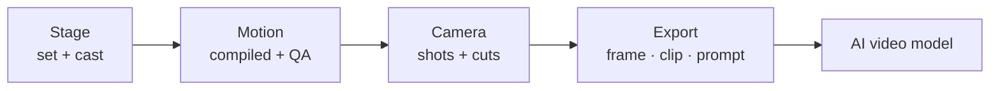

<p align="center">
  
</p>

<p align="center">
  <b>Make the scene first. Then make it a video.</b><br>
  <em>Open source previs in a browser tab: block the set, move the cast, cut the camera, hand the shot to an AI video model.</em>
</p>

<p align="center">
  <a href="LICENSE"></a>
  <a href="https://www.npmjs.com/package/cozyclay"></a>
  
  <a href="https://github.com/NomaDamas/CozyClay/stargazers"></a>
  <a href="https://discord.gg/Hp9V5wwgjF"></a>
</p>

<p align="center">
  <a href="https://cozyclay.org/#try">Try it in the browser</a> ·
  <a href="#quick-start">Quick start</a> ·
  <a href="INSTALL_FOR_AGENTS.md">Guide for AI agents</a> ·
  <a href="#docs">Docs</a> ·
  <a href="CHANGELOG.md">Changelog</a> ·
  <a href="https://discord.gg/Hp9V5wwgjF">Discord</a>
</p>

<table>
  <tr>
    <td width="50%"><video src="https://github.com/user-attachments/assets/00f28c2f-e8e2-43eb-b253-b6c2436e1818" controls muted width="100%"></video></td>
    <td width="50%"><video src="https://github.com/user-attachments/assets/4c9b1e29-4803-435c-8305-f2c899fb1c2c" controls muted width="100%"></video></td>
  </tr>
  <tr>
    <td align="center"><sub>Top: the greybox blocked in CozyClay. Bottom: the AI video made from it.</sub></td>
    <td align="center"><sub>Same idea, a parkour jump: the blocking holds the timing and the camera.</sub></td>
  </tr>
</table>

## Why

AI video costs money per take, and one miss means paying again. A text prompt cannot hold a
whole scene: where everyone stands, how they move, where the camera is, when it cuts.

CozyClay lets you make those decisions first, in 3D, where they are cheap to change. Then the video
model gets the shot as a first frame, a greybox reference clip and a prompt that describes the
real framing. It follows the blocking instead of guessing.



## Quick start

```bash
npx cozyclay
```

That is the whole install. You need Node.js 22.19 or newer and a Chromium browser. You do not need
a GPU, Python or a model download. The studio opens at `http://127.0.0.1:5180/app/`.

**Updating.** `npx cozyclay` fetches the newest release each time you run it. After
`npm install -g cozyclay`, the studio shows a small **Update** chip in the top bar when a newer
release is out. **Update now** installs it, and then you restart `cclay`. `cclay update` does the
same from the terminal. `--no-update-check` or `COZYCLAY_NO_UPDATE_CHECK=1` turns the check off
for one launch; `cclay update --off` turns it off for good, and `cclay update --on` brings it back.

> **Asking an AI agent to set it up?** Give it this repository link. Its instructions are in
> [`INSTALL_FOR_AGENTS.md`](INSTALL_FOR_AGENTS.md).

## What you can do

| | |
| --- | --- |
| **Stage** | Build the set from primitives. Add rigged characters, or capsule stand-ins when nobody needs to move a limb. Fly the view like a 3D editor. |
| **Move** | Describe the action. The agent writes a motion spec, and a deterministic compiler in the browser bakes every frame. QA checks collisions, foot slide, reach and hand contact before you see it. |
| **Shoot** | Put shots on a timeline, draw dolly rails, look through the lens. Each shot knows the limits of the video model you target. |
| **Export** | Keyframe pack (first and last frame, greybox clip, camera, prompt), mp4, depth and normal passes, contact sheet, OTIO cut list. |
| **Storyboard** | Prefer stills? A Storyboard project is a row of panels with captions, an animatic and a contact sheet. |
| **Undo anything** | Every edit, including each change the agent makes, is one undo step. |

## Direct it with AI

The same scene can be driven from three places, live, while you watch the viewport.

| Surface | Start | For |
| --- | --- | --- |
| **Agent panel** | `Cmd/Ctrl+B` in the studio | Chat in the studio. Sign in with ChatGPT or use your own key (Anthropic, OpenAI, Gemini, MiniMax, OpenRouter, CLIProxyAPI). |
| **MCP server** | `npx -y cozyclay mcp` | Claude Desktop, Claude Code, Cursor or any MCP client. |
| **Terminal** | `cclay live status --wait` | Coding agents that drive a running studio, JSON in and out. |

```json
{ "mcpServers": { "cozyclay": { "command": "npx", "args": ["-y", "cozyclay", "mcp"] } } }
```

## From source

```bash
git clone https://github.com/NomaDamas/CozyClay.git && cd CozyClay
npm install
npm run dev     # http://127.0.0.1:5180/app/
npm test
```

## Docs

| Read | For |
| --- | --- |
| [`INSTALL_FOR_AGENTS.md`](INSTALL_FOR_AGENTS.md) | Install, run and connect, written for AI agents |
| [`docs/motion3-agent-guide.md`](docs/motion3-agent-guide.md) | Motion specs, compile and QA |
| [`docs/agent-cli.md`](docs/agent-cli.md) | `cclay live`, model providers, sessions |
| [`mcp/README.md`](mcp/README.md) | MCP tools and the live protocol |
| [`docs/studio-ui-ia.md`](docs/studio-ui-ia.md) | Every control and where it lives |
| [`docs/privacy.md`](docs/privacy.md) | Anonymous telemetry and how to turn it off (`cclay telemetry off`) |
| [`AGENTS.md`](AGENTS.md) | Contribution rules |

## Guides

| Read | For |
| --- | --- |
| [Greybox to AI video](https://cozyclay.org/greybox-to-video/) | Why a grey blockout is the most reliable input for a video model, and the block-then-generate loop |
| [Previs software compared](https://cozyclay.org/previs-software/) | Free, open source and browser-based previs tools side by side |
| [Seedance 2.5 camera control](https://cozyclay.org/seedance-camera-control/) | Getting the same camera on every take with a reference clip |
| [Camera control for AI video](https://cozyclay.org/ai-camera-control/) | Why camera prompts drift and what the models actually accept |

Found a bug or want a feature? [Open an issue](https://github.com/NomaDamas/CozyClay/issues).

## License

AGPL-3.0-or-later. See [`LICENSE`](LICENSE), [`LICENSING.md`](LICENSING.md) and
[`THIRD_PARTY_NOTICES.md`](THIRD_PARTY_NOTICES.md). Made by [Doyun](https://github.com/HaD0Yun) at
[NomaDamas](https://github.com/NomaDamas).
