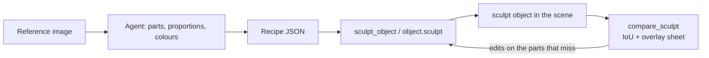
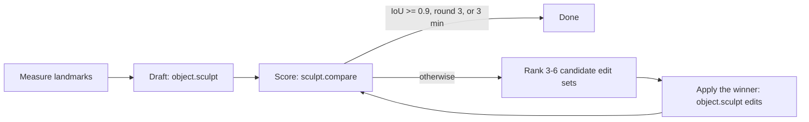

# Sculpt objects: a clay prop from one reference image

STATUS: implemented (#730); live QA: `mcp/qa-sculpt-live.mjs`

An agent looks at a reference image, breaks the subject into a handful of soft clay parts, and stands the result in the set as one object. The object is **data, not code**: a `sculpt` record carries a recipe of parts, and CozyClay builds the geometry from it. Nothing the agent writes is executed.

This is the previs-sized version of the img2threejs loop. Two runs (a chibi turtle in glasses and a sea-stack diorama) showed where the time goes: 70% of it went to camera fitting and to working around a code generator. A recipe that the editor renders directly removes both.



## Why a recipe and not a baked GLB

| | Bake a GLB, then `import_mesh` | `sculpt` recipe |
|---|---|---|
| Memory-only MCP | No: needs a live editor | Yes |
| Project export | Bytes live in IndexedDB and are lost | Inside the scene JSON |
| Agent edits | Rebake the whole model | Patch one part |
| Safety | File parsing | Plain data, validated |

## Recipe contract (v1)

```json
{
  "version": 1,
  "parts": [
    { "id": "head", "shape": "blob", "size": [1.5, 0.84, 1.1], "roundness": 0.6,
      "position": [0, 1.55, 0.03], "rotation": [0, 20, -6], "color": "#4a8e9c" },
    { "id": "eye", "shape": "blob", "size": [0.44, 0.36, 0.3], "parent": "head",
      "position": [0.38, 0.1, 0.48], "color": "#ece8ec", "mirror": true },
    { "id": "rim", "shape": "frame", "size": [0.76, 0.42, 0.07], "border": 0.09, "parent": "head",
      "position": [0.41, 0.1, 0.68], "color": "#240405", "mirror": true }
  ]
}
```

Units are metres, angles are degrees, the floor is `y = 0`, front is `+z`, and the subject's own left is `+x`.

| Field | Meaning |
|---|---|
| `id` | Unique part name, `a-z 0-9 -`. |
| `shape` | `blob`, `box`, `cylinder`, `torus`, `frame`, `lathe`, `tube`, `extrude`, `loft`, `convex` or `scatter`. See [Shapes beyond primitives](#shapes-beyond-primitives). |
| `size` | Full extents `[x, y, z]`. A torus reads `[outer diameter, outer diameter, tube diameter]`. |
| `roundness` | `blob`: 0 is an ellipsoid and 1 is a rounded box. `box`: the edge bevel as a fraction of the smallest side. |
| `taper` | `blob`, `cylinder`: −1 to 1. Positive values narrow the top and negative values narrow the bottom. A cylinder with taper 1 is a cone. |
| `border` | `frame`: the rim width in metres. A frame is a rectangular ring, like a glasses rim, a window or a picture frame. |
| `position`, `rotation` | Measured in the parent's frame when `parent` is set, otherwise in the object's frame. |
| `parent` | Another part's id. The part rides that part's position and rotation. |
| `mirror` | `true` adds a reflected copy across `x = 0` of the parent frame. This is a reflection and never a rotation. |
| `color` | `#rrggbb` clay colour. |

Limits: at most 48 parts after mirroring, each extent between 0.005 and 20 m, and parent chains at most 8 deep. A recipe that breaks a limit is refused with the reason. It is never clamped into a different shape.

### Shapes beyond primitives

Every shape stays inside its declared `size`, so the measured box never lies. Point lists are fractions of `size`, not metres.

| Shape | Fields | Use it for | Geometry |
|---|---|---|---|
| `lathe` | `profile: [[r, y], ...]` (3–32, r 0..1 of the half-width, y 0..1 bottom to top), `smooth?` | pot, vase, bottle, bowl, cup, lampshade, mushroom, bell | `LatheGeometry`, elliptical when size x ≠ z, capped ends |
| `tube` | `path: [[x, y, z], ...]` (2–32, each −0.5..0.5), `thickness` (m, diameter), `taper?`, `closed?` | rope, vine, cable, handle, hose, tail, branch, bike frame | `TubeGeometry` along a monotone cubic (no overshoot), round caps |
| `extrude` | `outline: [[x, y], ...]` (3–64, −0.5..0.5), `holes?` (≤ 4), `roundness?` bevel | sign, leaf, gable, gear, star, arrow, cutout silhouette | `ExtrudeGeometry` through `size[2]` |
| `loft` | `sections: [{ y, points: [[x, z]...] } \| { y, w, d, x?, z?, roundness? }]` (2–12, first y 0, last y 1), `smooth?` | boat hull, car body, shoe, squared bottle, loaf, wedge roof | `LoftGeometry` (three r185) with caps |
| `convex` | `points: [[x, y, z]...]` (4–48) or `seed` + `facetCount?` (6–40), `facets?` | rock, boulder, gem, crystal | `ConvexGeometry`, flat facets by default |
| `scatter` | `item: blade\|tuft\|flower\|leaf\|pebble\|twig`, `count` (≤ 4000), `spread: ground\|shell`, `seed?` | grass, flower bed, gravel, leaves on a crown | one `InstancedMesh`; counts as one part; ≤ 12000 items per recipe |

Fields any part takes:

| Field | Meaning |
|---|---|
| `material` | `clay` (default), `wood`, `straw`, `stone`, `brick`, `concrete`, `metal`, `glass`, `ceramic`, `plastic`, `rubber`, `fabric`, `paper` or `foliage`: a procedural, triplanar-mapped surface with bump and shine (`src/material-look.js`); `color` stays the tint. Glass refracts and casts no shadow. Plain objects take the same field through `object.set`. |
| `finish` | `matte`, `satin` or `gloss`: overrides the preset's shine (metal + gloss = chrome, glass + matte = frosted). |
| `detail` | `{ amount 0..1, scale? 1..12, seed? }`: seeded noise pushes the surface in and out (clouds, bushes, rocks, hay, bread). Seams are welded first. |
| `gradient` | `{ color, axis? y\|x\|z, from? 0..1, to? 0..1 }`: vertex colours blend `color` into the second colour along the part's axis. Ignored by the flat display modes. |
| `op` | `subtract` or `intersect`: the part is not drawn; it cuts its `parent` with three-bvh-csg (windows, doors, arches). Hollow a lathe with a smaller lathe of the same profile: a boxy cutter pokes through a round wall. Cut deeper than the wall; `mirror: true` cuts both sides. A cutter has no children and never enlarges the standing box. |

Compare scores these by their outline: a tube is hulled per segment, an extrude per triangle and a loft per pair of sections, so concave shapes stay honest. It ignores cutters and detail lumps, and treats a ground scatter as its whole box.

The record stores the normalized recipe, plus `footprint` and `height` measured from the parts' bounds, so the plan board, the drop logic and the selection cage work without building geometry.

## Editing and comparing

- **Patch, don't resend.** `sculpt_object { id, edits }` (Studio: `object.sculpt`) applies `{ set: partId, ...fields }`, `{ add: part }` and `{ remove: partId }` in order. `parent: null` and `mirror: false` clear those fields, and `remove` also takes the part's children. Changing `shape` drops the old shape's options. The patched recipe is validated as a whole, and the receipt names the parts that changed.
- **Compare against the reference.** `compare_sculpt { id, reference: "<png|jpg path>", yaw?, elevation? }` runs on this machine without an editor. It turns the reference's subject into a mask: alpha when the image has transparency, otherwise everything that differs from the border colour. It draws the sculpt's silhouette orthographically from the view, fits it to the subject's height, top and best horizontal offset, and returns:
  - `iou`, `missingFraction`, `extraFraction`
  - `widthToHeight` (reference vs sculpt)
  - `missingByBand` (top, middle, bottom thirds: where to add)
  - `extraByPart` (which parts stick out)
  - a sheet: the reference beside an overlay (grey = both, red = missing, blue = extra)

  Leaving out `yaw` tries −45° to 45° and keeps the best. Only shape is scored, not colour.
- **Try several fixes at once.** `compare_sculpt { id, reference, candidates: [{ label, edits }, …] }` scores up to 12 alternative edit sets from the same view in one call and applies none of them. It returns a ranking against the current sculpt (IoU, delta, bands, parts) and the winner's sheet. Apply the winner with `sculpt_object { id, edits }`. Each candidate costs about 0.1 s of local computation and no model turn, so in one round the agent can test one idea per mismatch instead of guessing which single fix is right.
- **One round, one call.** `sculpt_object { …, capture: true }` returns the editor frame with the receipt when an editor is connected.

## Agent workflow (image → sculpt)

1. **Measure the image before writing anything.** Find the subject's bounding box, then where each limb tip, the head top and the feet sit as fractions of its height, and convert those to metres. The best draft in the measurements below came from this step, not from iteration.
2. **Read the image for identity.** Name the subject, the parts and their contact relationships. List the 3–5 features that make the subject recognizable (for the turtle: oversized glasses, bulging eyes, the buck tooth, the belly plate). Say which sides the image hides.
3. **Block out from the measurements.** Put parts on the measured landmarks; a few small parts (claws, ears) are fine where the outline has them.
4. **Place it, then score.** Call `sculpt_object`, then `compare_sculpt` with the reference path. Read `missingByBand` and `extraByPart` before you look at the sheet.
5. **Patch, don't rewrite.** Write 3–6 candidate `edits` (one per mismatch you see), rank them with `compare_sculpt { candidates }`, and apply the winner. Fix the biggest mismatch first: proportion, then placement, then colour. Allow three rounds at most, or stop once IoU stops rising, then report what still differs.
6. **Identity details last.** Add eyes, rims and plates as small parts on a parent once the body reads.

Ask, infer and omit follow `agent-prompt-to-scene.md`. Infer the hidden back and say so. Never ask for more views unless the user wants a likeness.

## Sculpt mode (#739)

Sculpt mode is the Studio's fifth viewport mode. It runs the workflow above for you on one sculpt, on an isolated turntable.

**Running it**

1. Press **5**, or pick Sculpt in the viewport mode toolbar. If a sculpt is selected, the mode opens on that sculpt and a run re-sculpts it in place. Otherwise the first run creates a new sculpt. The main view shows only that sculpt on a turntable; W, E and R swing it to front, side and back. The shot preview still shows the whole scene.
2. Drop, paste or choose a reference image (PNG, JPEG or WebP) in the **Sculpt from image** panel.
3. Pick the **model** and its **effort**. The list is the Agent panel's: models are grouped by provider, and a provider without a credential lists its models disabled. Sculpt remembers its own pick, apart from the chat model. The first time, it starts from the Agent panel's model. Both pickers are locked during a run, and the panel names the running model ("Claude Fable 5.1 is writing the recipe").
4. Press **Start**. Start needs the Agent: sign in (⌘B) or configure a provider key, and the live editor must be connected. Without them the button stays disabled and the panel says why.
5. Watch the stages: **Measure → Draft → Score → Refine**. The panel shows the round, the elapsed time, the IoU against the 0.9 target and, once scored, the overlay sheet. **Cancel** stops the run at any point.
6. Fix details by chatting with the Agent (⌘B) while the sculpt is selected. These are ordinary `object.sculpt` edits, one undo each.
7. Press **Place in scene**. The sculpt stands on the ground in front of the scene camera, stays selected, and the editor returns to Stage. One undo puts it back where it was.

| Mode 5, nothing selected | A sculpt on the isolated turntable | After Place in scene |
|---|---|---|
|  |  |  |


**Picking a part**

Click a part of the sculpt on the turntable to select it. The part gets an outline in the selection colour, and its row is highlighted in the **Parts** tree in the Sculpt panel. The tree lists the recipe's parts, children indented under their parent. Clicking a row selects that part as well.

- A mirrored part is listed once and drawn twice (`blob ×2`). Clicking either copy selects the recipe's part and outlines both. A click on the copy marks the row **mirror copy**.
- The scene selection does not change: the sculpt stays the selected object.
- A drag still orbits the turntable. Only a click without movement picks.
- A click on empty space, or Esc, clears the part. Esc clears the part first, then the scene selection as before.

**Blueprint (model sheet)**

Once a reference is in, **Generate blueprint** makes one image request (gpt-image-2, ChatGPT sign-in) that turns the reference into a four-view orthographic model sheet: FRONT and LEFT SIDE on the top row, sharing their head and foot lines, then BACK and TOP. The request is a fixed, subject-agnostic template (`src/sculpt-blueprint.js`). It asks for:

- true orthographic panels at one scale, with no perspective
- the same identity, colours and pose as the reference (or a neutral rest pose)
- nothing that is not part of the subject (motion lines, shadows, fabric texture)
- a plain white background and no text

The operator adds only optional notes. The exact request can be read in the panel. The sidecar sends it as written (`composition: "sheet"`, 1536×1024, quality high). Well-known characters are often refused by the image model's safety system, and the panel says so.


*Generated in 23 s from a flat embroidered-patch design. The side and top views supply the depth the front cannot. The sheet is not yet used by the sculpt run.*

**While it runs**

The run says what it is doing at every moment, so a long model call never looks like a hang:

- **The wait line** names what the run is waiting on, counts the seconds and shows the usual length of that wait. Examples are "Agent is writing the recipe … 29s, usually ~60s" and "Agent is test-fitting 4 candidate fixes". A lump of clay kneads beside it. If a wait runs past 1.5× its usual length, the line says so. A tool call inside a turn never resets the turn's own count.
- **The activity log** has one timed line per event: the outline measured, a recipe refused and why, the draft landing with its part count, each score with its change, the candidate ranking, the agent's closing words.
- **On the reference** a scan line sweeps while the outline is measured. The measured slices then stay drawn over the picture.
- **The IoU trail** plots the score after each round against the target line, with a floating +/− chip. **The candidate race** grows each fix's bar in and stars the leader. The overlay sheet opens by itself.
- **The turntable** shows a kneading lump of clay until the first draft lands. It turns slowly while the run works, and it stops for good once you grab it. The parts an edit just changed glow warm for a moment.

| Writing the draft (30 s) | Round 2, ranking fixes (105 s) |
|---|---|
|  |  |

**What the run does**



- Each round is one agent turn. The first turn measures the reference outline (limb tips, head top and feet as fractions of height) before it places any parts, then drafts and scores. Each later turn ranks 3–6 candidate edit sets with `sculpt.compare { candidates }`, applies the winner and scores again.
- The harness owns the score. Each turn's text gives the exact `sculpt.compare` arguments, including the stored reference's `assetId`. If a turn ends without a successful score, the harness runs `sculpt.compare` itself, so the stop decision and the next round's text always use a real IoU.
- The run stops at the first of: IoU ≥ 0.9, 3 rounds, or a 3-minute budget. The budget is checked between turns, so the turn in flight finishes first. A turn that ends without an `object.sculpt` is retried once with a firm reminder; a second miss fails the run. A turn the sidecar refuses fails the run at once with the refusal.
- Each run sends one `sculpt_run` analytics event when it ends. It carries the outcome (`done`, `cancelled` or `failed`), the rounds, the final IoU rounded to 0.01, the duration in ms, and whether the run re-sculpted an existing sculpt. It never includes the image, the recipe or any names.

**Measured in a live editor (Snorlax reference, Studio agent gpt-6-astra, 2026-10-11)**

Every row is one real run, from pressing Start to Done, in a real editor tab. Each row lists the fix that went in before that run.

| Run | Change before the run | Wall time | Rounds | IoU |
|---|---|---|---|---|
| 1 | — | 2 s | 0 | — (the sidecar refused the turn: the session id was not a UUID) |
| 2 | UUID session; refused turns fail the run | 198 s | 3 | — (every agent `sculpt.compare` named the file, not the asset) |
| 3 | Exact `reference` in the text; the harness scores unscored turns | 209 s | 1 | 0.742 |
| 4 | Read-only jobs in an agent turn get no undo entry; recipe rules in the text | 230 s | 2 | 0.778 |
| 5 | The harness measures the outline in pixels; a candidate score taken before an edit is not reused | 181 s | 3 | 0.734 |
| 6 | First turn at effort "high" (reverted afterwards) | 253 s | 1 | 0.773 |
| 7 | Final settings: default effort; the text says which shapes take roundness and taper | 206 s | 2 | **0.771**, no refused recipe |
| 8 | Same harness, model switched in the new picker to **Claude Fable 5.1** (cliproxy) | **116 s** | 2 | **0.911**: target reached |


The loop is now reliable: no refused turns, no stale scores, and three rounds fit in about three minutes. **The model decides the result.** On gpt-6-astra the first draft lands at 0.73–0.78 and candidate rounds add little. The same harness on Claude Fable 5.1 reached **0.911 in 116 s** (run 8). The drafts that reached 0.945 (see below) came from a stronger model that measured the image and spent minutes on a 31-part recipe. Raising the draft's quality is follow-up work (#740: generated views, parallel drafts).

## Measured: one loop vs parallel (Snorlax, 2026-10-11)

Same reference, a front view with both arms raised. Scores come from `compare_sculpt` at yaw 0 and were re-run independently afterward.

| Approach | Wall time | Best IoU | Notes |
|---|---|---|---|
| One agent, whole-recipe rounds (3 rounds) | 76 s | 0.761 | Guessed one fix per round; two rounds barely moved |
| One agent, `candidates` (3 rounds × 6 fixes) | 23 s | 0.793 | Same start; each round kept the best of six |
| Three agents in parallel, different decompositions (body-first / silhouette-trace / segmented) | 639 s (slowest agent) | **0.945** | Silhouette-trace won in its first draft (31 parts). All three stopped after round 1 and had to be resumed; after resuming, one rewrote a worse 10-part recipe and the best stayed round 1 |

What this says:

- **Measuring the reference beats iterating on a guess.** The 0.945 draft measured the outline in pixels (where each arm tip and foot sits) before writing parts. That one change was worth more than every later round in every run.
- **`candidates` is the cheap speed-up.** 6 fixes cost under 1 s, so a round never applies a fix that makes the sculpt worse.
- **Parallel decompositions buy quality, not speed.** About 3× the tokens and the slowest branch's wall time, for a better first draft. They are worth it for a hero prop and not for set dressing.
- **Stop when a round stops paying.** Candidate refinement on the 0.945 winner found nothing better (+0.000). Every agent's later rounds were flat or worse.


## Plan

| Step | Deliverable |
|---|---|
| 1 | `src/sculpt-recipe.js`: normalize, validate and measure bounds. Pure, with node tests. |
| 2 | `src/sculpt-geometry.js`: recipe to three.js Group (blob = superellipsoid radial remap). |
| 3 | `sculpt` kind: create, normalize, duplicate, serialize, render, hierarchy and inspector. |
| 4 | Studio action `object.sculpt` and MCP `sculpt_object`, in live and memory mode. |
| 5 | Agent rules (this page) in the MCP tool description and the Studio prompt. |
| 6 | QA: the turtle recipe through MCP into a live editor, with a screenshot in the PR. |
| 7 | Part-level `edits`, `compare_sculpt` (reference mask, silhouette IoU, overlay sheet), `capture: true`. |

Out of scope, for follow-ups: saving a sculpt to the asset shelf, a gizmo that moves, turns and scales the picked part (picking itself is in, see **Picking a part**), and textures.
