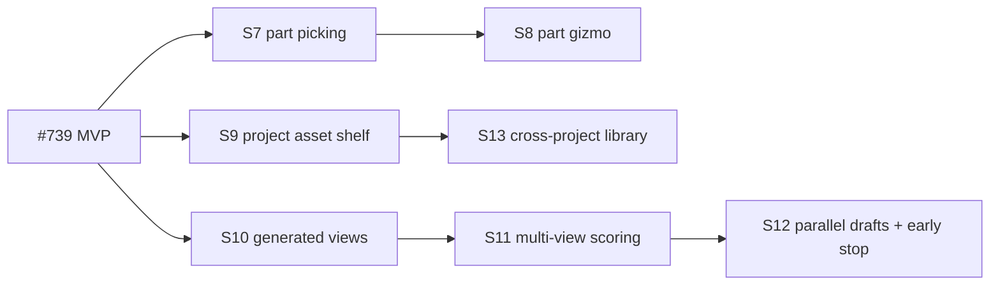

# Sculpt mode: roadmap after the MVP (#740)

The MVP (#739) adds **5 Sculpt** mode with these pieces:

- an isolated turntable
- the Sculpt panel
- a harness-driven Studio agent run (measure → draft → score → candidates, at most 3 rounds, target IoU 0.9)
- chat edits
- Place in scene

This document plans the work after it. Decisions come from the design interview of 2026-10-11.

## Decisions that carry over

| Item | Decision |
|---|---|
| Engine | An LLM writes the clay recipe. No mesh model. The recipe stays editable part by part |
| Home | Viewport mode **5 Sculpt**, isolated turntable plus a scene preview inset |
| Who runs it | The Studio agent runtime, with a harness that owns the loop. Sign-in is required |
| Direct editing | Viewport gizmo on parts (W/E/R) |
| High quality | Generate the hidden views with the built-in image model and use them as references automatically |
| Asset shelf | Reuse within the project first (existing shelf), then a library shared across projects |

## Phase 2: direct editing and reuse

### S7 Part picking
- Clicking the sculpt in Sculpt mode picks the **part** under the pointer: the ray hits a part mesh, and the mesh's `userData.partId` gives the part. A mirrored copy resolves to its source part id plus a `mirrored` flag.
- The picked part gets an outline highlight. The inspector shows the part tree (parent chains) and keeps it in sync with the viewport.
- **Done when:** picking works on parented and mirrored parts. Picking a part never selects the whole object while in Sculpt mode.

### S8 Part gizmo
- W/E/R act on the picked part in the object frame. On release, one `object.sculpt { id, edits: [{ set: partId, position | rotation | size }] }` = one undo entry.
- A part with `mirror` moves as a pair: the edit is written once on the source part, and the mirror follows from the recipe.
- A refused edit (out of bounds, invalid size) snaps back and shows the refusal path.
- Scale edits `size` directly. Uniform scale is Shift + drag.
- **Done when:** the recipe values after a drag equal the gizmo's values (±1e-4). Undo after a drag restores the recipe exactly.

### S9 Project asset shelf
- **Save to shelf** on a sculpt writes a card: the recipe JSON, a turntable thumbnail (front 3/4 render, 256 px) and the name. It uses the existing shelf store, where a recipe asset is a small JSON blob.
- Dragging a card into any scene of the project creates a sculpt from the recipe at the drop point.
- Cards survive reload and project export/import.
- **Done when:** a card created in scene 1 can be dropped into scene 2. Deleting the source sculpt keeps the card.

## Phase 3: high quality

### S10 Generated views
- High-quality Start first asks `/agent/image` (gpt-image-2) for **side** and **back** views of the same subject: same style, plain white background, centred, orthographic-looking, front reference attached.
- The views are used at once (no approval step) and shown as thumbnails in the panel. Clicking a thumbnail regenerates that view.
- Only accounts with image generation (ChatGPT sign-in) see the button. Others see why it is unavailable.
- **Done when:** each view gives a single connected mask through the existing reference mask code. A view whose mask fails is dropped with a visible note.

### S11 Multi-view scoring
- `sculpt.compare { id, views: [{ yaw, reference, weight }] }` scores each view at its yaw and returns a weighted IoU plus each view's report.
- Default weights: front 0.6, side 0.25, back 0.15. Generated views can contradict each other, so the front leads.
- A view whose height:width ratio differs from the front by more than 35% is down-weighted to 0 and reported.
- **Done when:** the weighted IoU equals the hand-computed value in a fixture test, and the front-only result equals the MVP's IoU.

### S12 Parallel drafts with early stop
- High-quality runs start 2–3 drafts in parallel with different decompositions (silhouette-trace, body-first, segmented). The harness scores each draft as it lands and **cancels the others** once one reaches the target IoU. Candidate refinement then runs on the winner only.
- Budget: 5 minutes of wall time, with tokens logged per run (`sculpt_run.tokens`).
- **Done when:** on the Snorlax reference the winner is chosen within 2 minutes and the losing runs leave no objects in the scene.

### S13 Cross-project library
- **My sculpts** library shared across projects, stored in the same place as other user-level assets.
- Recipe import/export as `.cozysculpt.json`.

## Known risks

| Risk | Handling |
|---|---|
| The agent stops partway | The harness owns the loop (already in the MVP); parallel drafts inherit it |
| Generated views disagree with the front | Front-led weights, the ratio check and per-view reports (S11) |
| Gizmo vs mirror semantics | Write edits to the source part only; the mirror is derived (S8) |
| App.jsx conflicts | S7 is the only App.jsx-heavy item; it runs alone |
